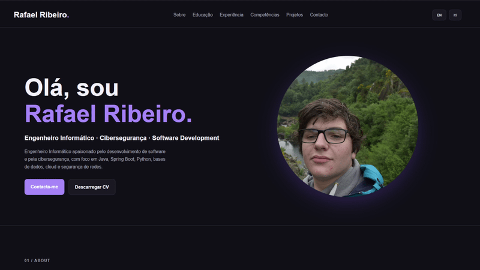

# Personal Portfolio | Rafael Ribeiro

Este projeto consiste num portefólio pessoal que funciona como uma versão digital do meu currículo, permitindo apresentar o meu percurso académico e profissional de forma simples, organizada e acessível.

Foi desenvolvido com HTML, CSS e JavaScript, incluindo um design adaptável a diferentes dispositivos e várias funcionalidades:
- Alternância entre modo claro e modo escuro.
- Suporte para dois idiomas (Português e Inglês).
- Secções dedicadas à apresentação pessoal, formação académica, experiência profissional, competências técnicas e projetos.
- Ligações para os meus projetos, GitHub e LinkedIn.
- Possibilidade de consultar e descarregar o meu currículo em formato PDF.

Este projeto teve como principal objetivo criar uma presença profissional online, disponibilizando uma forma alternativa e mais acessível de apresentar o meu CV e portefólio.

## Podes visualizar o projeto aqui:
https://rafaelribeiro2003.github.io/rafael-ribeiro-portfolio/

## Screenshot:

## Créditos: 
Rafael Ribeiro
---
## 🇬🇧 English

This project consists of a personal portfolio that serves as a digital version of my CV, allowing me to present my academic and professional background in a simple, organized and accessible way.

It was developed using HTML, CSS and JavaScript, featuring a responsive design and several functionalities:
- Light and dark mode toggle.
- Support for two languages (Portuguese and English).
- Sections dedicated to personal introduction, education, professional experience, technical skills and projects.
- Links to my projects, GitHub and LinkedIn profiles.
- Option to view and download my CV in PDF format.

The main goal of this project was to establish a professional online presence, providing an alternative and more accessible way to showcase my CV and portfolio.

## Live Demo
https://rafaelribeiro2003.github.io/rafael-ribeiro-portfolio/

## Screenshot

## Credits
Rafael Ribeiro
